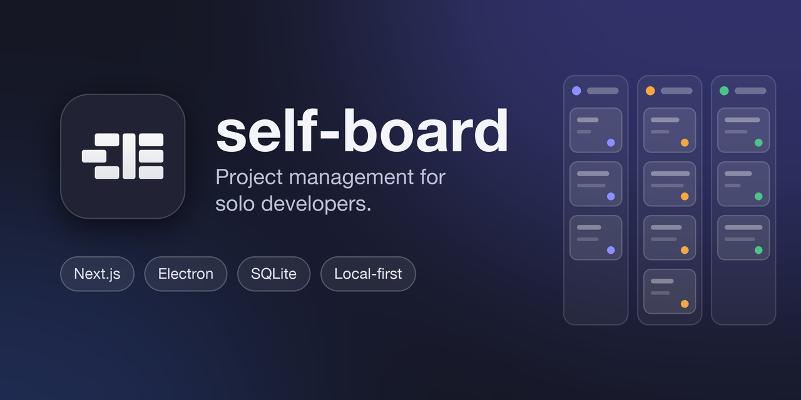

<p align="center">
  
</p>

<h1 align="center">
  
  &nbsp;self-board
</h1>

<p align="center">
  A Linear-style project management app for solo developers.<br>
  Runs in the browser as a Next.js app, or on the desktop packaged with Electron.<br>
  All data lives on your machine in a single SQLite file — no server, no account, no network.
</p>

<p align="center">
  
  
  
  
  
</p>

## Features

- **Projects** — each with its own issue ID prefix (`COR-12`), color and icon.
- **Issues** — status, priority, assignee, labels, a rich-text description (including
  image upload and link previews) and notes.
- **Configurable workflow** — board columns are defined per project: add, delete,
  rename, reorder, and assign a color and icon.
- **List and board views** — pick the grouping field (status, assignee, priority, label,
  cycle); dragging on the board changes the selected field; both views have a
  right-click menu.
- **Cycles** — Linear-style automatically recurring periods, carry-over of unfinished
  issues, burnup and velocity charts, and a capacity gauge.
- **Saved views** — named snapshots of filter and view settings.
- **Backup** — under Settings > Data: a JSON dump and a full copy of the database file
  (images included), with restore from the same place.
- **Optional modules** — off by default, enabled under Settings > Modules:
  - **Wiki** — nested pages for each project; auto-saved rich text, images, clickable
    issue links such as `COR-12`, last-edited info, and search from the command palette
    (Ctrl/⌘+K).
- **English and Turkish UI**, light / dark / system theme.

## Getting started

```bash
npm install
npm run dev          # http://127.0.0.1:3000 (reachable from this machine only)
npm run electron:dev # Next dev server + Electron window together
```

Verification:

```bash
npx tsc --noEmit
npm run lint
npm test             # node:test + tsx; pure helpers and in-memory SQLite for
                     # schema/migrations, deletion, write validation, cycle
                     # carry-over, restore, attachment ownership, wiki tree
npm run build
```

## Desktop build

```bash
npm run electron:build
```

Packages the `next build` output as a standalone server, starts it on a random local
port using Electron's own Node runtime, and writes the installer to `release/`. In the
packaged app the database lives in Electron's `userData` directory
(`%APPDATA%/self-board/self-board.db` on Windows).

## Architecture

| Layer | Location | Notes |
| --- | --- | --- |
| Pages | `src/app/(app)/` | All `force-dynamic`; SQLite is read on every request |
| Settings | `src/app/settings/` | Outside the `(app)` group: takes over the window and has its own sidebar |
| Reads | `src/lib/data/` | Queries deduplicated per request with React `cache()` |
| Writes | `src/lib/actions/` | Server Actions returning `ActionResult<T>`, calling `revalidatePath` |
| Schema | `src/lib/db/schema.ts` | DDL + hand-written forward-only migrations |
| Modules | `src/lib/modules/` | `registry.ts` + one folder per module (e.g. `wiki/`); components in `src/components/<module>/` |
| Components | `src/components/ui/` | Radix-based design system |
| Desktop | `electron/` | Main process, preload, standalone preparation script |

A few deliberate decisions:

- **Foreign keys are enforced, but cascades are not relied on.** `node:sqlite`
  turns `PRAGMA foreign_keys` on by default, so a write pointing at a non-existent row
  throws. However, columns added to older databases with `ALTER` (e.g.
  `issues.project_id`) have no `REFERENCES`, and some relations have no `ON DELETE`
  either. Deletion cleanup is therefore done explicitly, starting from child rows, in
  `src/lib/db/cascade.ts` and the relevant actions (`deleteLabel`, `deleteUser`,
  `deleteWorkflowState`) — follow the same order when adding a new delete path.
- **Input is validated on the server.** Server Actions are public endpoints; rules such
  as "the state/cycle must belong to the issue's project" live in
  `src/lib/db/validation.ts`. An FK constraint only catches "a row that doesn't exist",
  not "a row from another project".
- **The schema is versioned** via `PRAGMA user_version`; migrations run inside a single
  transaction (`ensureSchema`). A new migration is added as an `if (version < N)` block.
- **States are user-defined, types are fixed.** `workflow_states` rows are per project
  and freely editable, but every state maps to one of five fixed system types
  (`backlog`, `unstarted`, `started`, `completed`, `canceled`). Cycle carry-over, the
  burnup chart and the success percentage look at a state's type, not its name —
  without types, free-form columns would make those metrics meaningless. The types live
  in `src/lib/board/workflow-config.ts`. The old `status` column on `issues` was
  intentionally not dropped after the migration: removing a `CHECK`-constrained column
  in SQLite requires rewriting the table.
- **Cycles are generated without cron.** `getCycles()` catches finished cycles at
  request time, carries over unfinished issues and writes a daily snapshot. In other
  words, a read path performs a write; the full rationale is in
  `src/lib/data/cycles.ts`.
- **`src/components/ui/` contains only components that are used.** There is no separate
  design system catalog; if a component isn't used anywhere in the app, it gets deleted.
- **Preferences are split in two.** Settings the server needs to read (start page, new
  issue defaults, date format) live in the `app_settings` key-value table; their types
  and defaults are in `src/lib/preferences-config.ts`, kept DB-free so client components
  don't pull `node:sqlite` into the bundle. Language is in a cookie (so the server
  renders the right language on first paint), theme is in `localStorage`.
- **Modules are toggled by visibility, with no install step.** Each module's tables
  (`ModuleDefinition.ddl`) are created by `ensureSchema` even while the module is off;
  turning it off doesn't delete data, it only hides the nav entry and the route (the
  route calls `notFound()`, actions return `module-disabled`). A new module is a single
  entry in `MODULE_REGISTRY`: the sidebar, Settings > Modules, project deletion
  (`onProjectDeleted`), backup/restore (`tables`) and attachment cleanup
  (`attachmentRefsSql`) pick it up automatically. Command palette search needs one line
  in `src/lib/modules/server.ts`.
- **The registry enters the client bundle.** The module file imported by `registry.ts`
  (e.g. `wiki/schema.ts`) may only contain `import type`, constants, and pure functions
  that take a `db` parameter; runtime imports of `@/lib/db/*` or `node:*` are forbidden.
  A module's server code (`wiki/db.ts`, `data.ts`, `actions.ts`) lives in separate files.
- **Attachment ownership is decided in one place.** Issue attachments are bound by
  `attachments.issue_id`; module attachments by the module's own mapping table (e.g.
  `wiki_page_attachments`). Core never deletes an attachment a module uses, it only
  detaches it from the issue; attachments used nowhere are collected after 24 hours by
  `pruneOrphanedAttachments`. Because the same image can be in both an issue and a wiki
  page (copy-paste), modules never delete BLOBs.
- **The wiki editor freezes its content when it attaches.** Autosave revalidates
  `/wiki` (otherwise the browser's Back button would bring up stale content, and typing
  over it would overwrite the new content); feeding a fresh `page.body` from the server
  to the editor would erase what was typed while a save was in flight. The editor is
  mounted with `key={page.id}` and only `updatedAt` is read from the server.
- **Design tokens** live in `src/styles/tokens.css`. The dark theme values come from
  Linear's Figma community file; the light theme is derived.

## For agents

`AGENTS.md` is written by `next dev` and reminds you that this Next.js version may
differ from your training data. Read the relevant guide under
`node_modules/next/dist/docs/` before writing any code.
